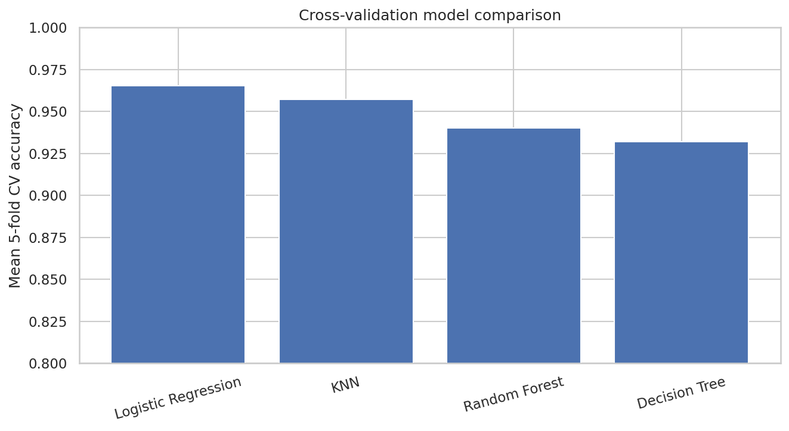
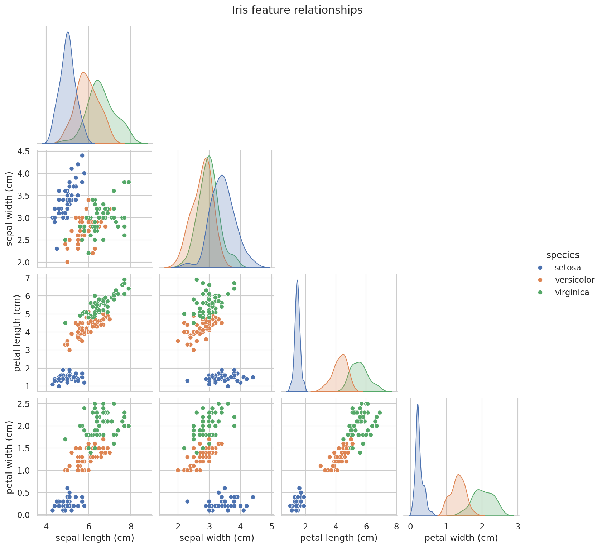
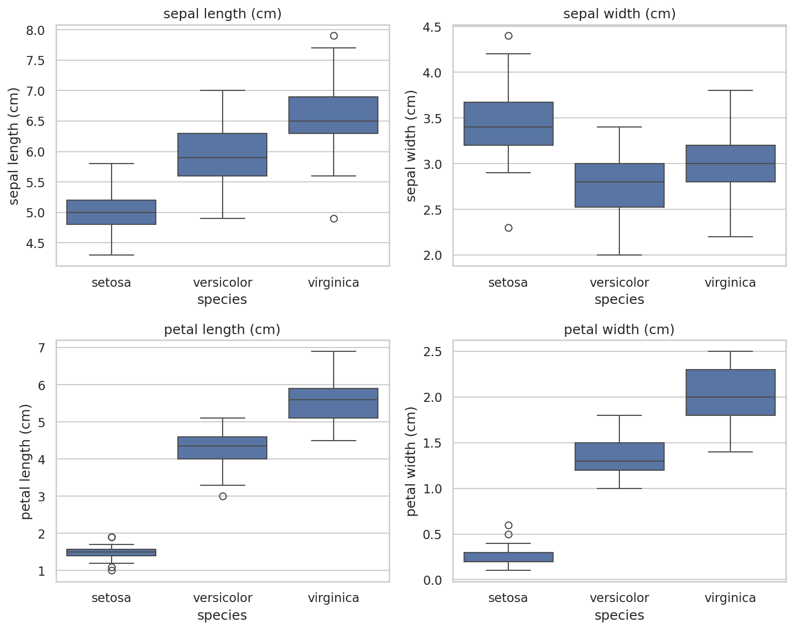
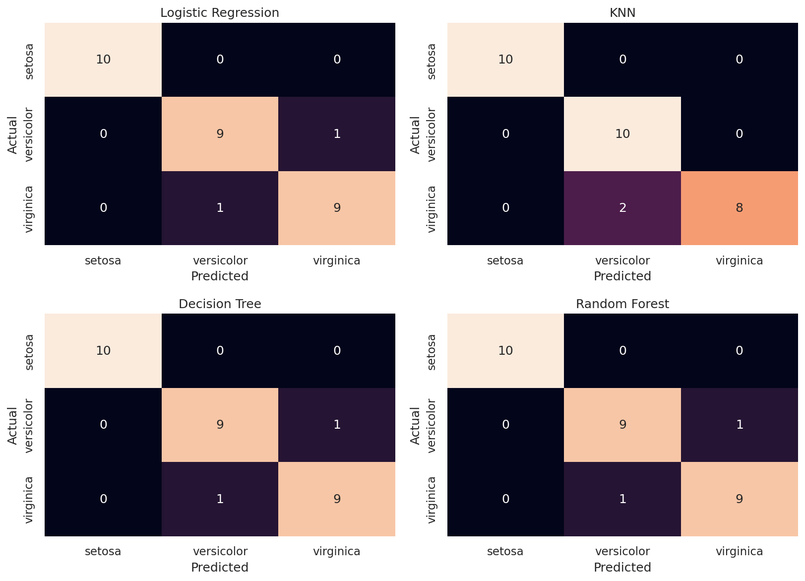
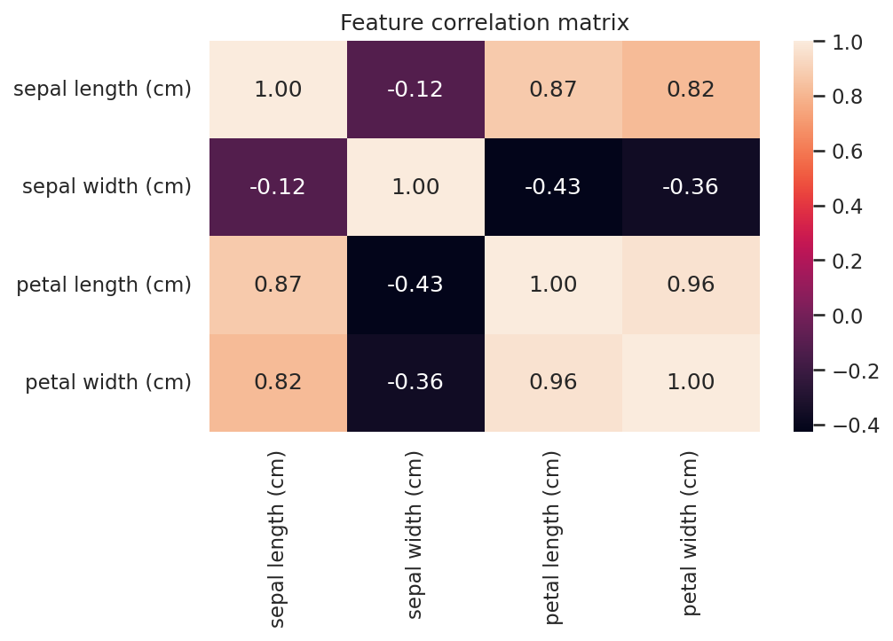

# Iris Flower Classification 🌸

[](https://www.python.org/)
[](https://scikit-learn.org/)
[](https://jupyter.org/)

An end-to-end **machine learning classification project** using the classic **Iris dataset**. The project explores the data, visualizes feature relationships, trains four classical classifiers, evaluates them on a held-out test set, and compares them using stratified 5-fold cross-validation.

## 🎯 Objective

Predict the species of an iris flower — **setosa, versicolor, or virginica** — from four measurements:

- Sepal length
- Sepal width
- Petal length
- Petal width

## 📊 Dataset

The dataset is loaded directly from `sklearn.datasets.load_iris()`, so no external dataset download is required.

| Property | Value |
|---|---:|
| Original samples | 150 |
| Features | 4 numeric measurements |
| Classes | 3 |
| Duplicate rows removed | 1 |
| Samples used after cleaning | 149 |

The classes remain nearly balanced after removing the duplicate.

## 🔬 Workflow

The notebook follows a complete, reproducible ML workflow:

1. Load the Iris dataset
2. Inspect shape, data types, missing values, duplicates, and class distribution
3. Remove the exact duplicate observation
4. Perform exploratory data analysis
5. Visualize feature distributions and pairwise relationships
6. Examine correlations between numeric features
7. Create a stratified 80/20 train/test split
8. Build preprocessing/model pipelines
9. Train four classification algorithms
10. Evaluate test accuracy, precision, recall, F1-score, and confusion matrices
11. Run stratified 5-fold cross-validation on the training set
12. Compare the models and document the experiment-specific result
13. Demonstrate a single example prediction

## 🤖 Models

The project compares:

- **Logistic Regression** — with `StandardScaler`
- **K-Nearest Neighbors (KNN)** — with `StandardScaler`
- **Decision Tree**
- **Random Forest**

Preprocessing for Logistic Regression and KNN is placed inside scikit-learn `Pipeline` objects. This prevents information from validation folds from leaking into the scaler during cross-validation.

## 📈 Results

The notebook evaluates every model on the same held-out test set and then uses 5-fold cross-validation on the training data.

The exact results are generated by the notebook, so the repository does not hard-code a universal "best algorithm" claim. The model with the highest cross-validation mean in **this specific experiment** is reported at the end of the notebook.

> Because the held-out test set contains only 30 observations, test accuracy can be tied between models. Cross-validation is included to provide additional information about performance across different splits.

### Cross-validation comparison



### Feature relationships



### Feature distributions



### Confusion matrices



### Correlation matrix



## 💡 Key Takeaways

- Petal measurements provide strong visual separation between the Iris classes.
- Setosa is clearly separated from the other two species.
- Versicolor and virginica have more overlap, which explains most classification errors.
- All four classical models perform strongly on this small, well-known dataset.
- Cross-validation is more informative than relying on a single small test split alone.
- The model selected by the notebook is the best performer **within this experiment**, not a general ranking of machine-learning algorithms.

## 🗂️ Project Structure

```text
iris-flower-classification/
│
├── Iris_Flower_Classification.ipynb   # Complete analysis and ML workflow
├── README.md                          # Project documentation
├── requirements.txt                   # Python dependencies
├── .gitignore                         # Files excluded from Git
├── LICENSE                            # MIT license
└── assets/                            # Figures used in this README
    ├── cv_model_comparison.png
    ├── pairplot.png
    ├── feature_boxplots.png
    ├── confusion_matrices.png
    └── correlation_heatmap.png
```

## 🚀 Run Locally

### 1. Clone the repository

```bash
git clone https://github.com/YOUR_USERNAME/iris-flower-classification.git
cd iris-flower-classification
```

### 2. Create and activate a virtual environment

**Windows**

```bash
python -m venv .venv
.venv\Scripts\activate
```

**macOS / Linux**

```bash
python3 -m venv .venv
source .venv/bin/activate
```

### 3. Install dependencies

```bash
pip install -r requirements.txt
```

### 4. Open the notebook

```bash
jupyter notebook Iris_Flower_Classification.ipynb
```

You can also open it with **JupyterLab** or **VS Code**.

## 🧪 Reproducibility

The train/test split and cross-validation use `random_state=42`. Model pipelines also use fixed settings where randomness is involved. Running the notebook from top to bottom reproduces the reported experiment.

## 🔮 Possible Extensions

- Hyperparameter tuning with `GridSearchCV` or `RandomizedSearchCV`
- Feature selection and dimensionality reduction
- Additional classification algorithms
- ROC/AUC analysis
- Model persistence with `joblib`
- Interactive prediction interface using Streamlit
- Deployment as a small web application

## 🛠️ Tech Stack

- Python
- NumPy
- Pandas
- Matplotlib
- Seaborn
- Scikit-learn
- Jupyter Notebook

## 👩‍💻 Author

**Salma Hossam**  
GitHub: [@salmahossam1](https://github.com/salmahossam1)

## 📄 License

This project is licensed under the [MIT License](LICENSE).
