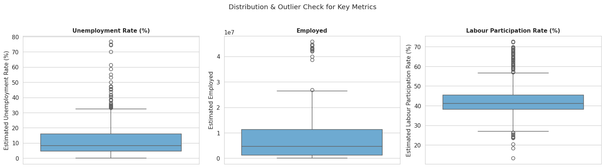
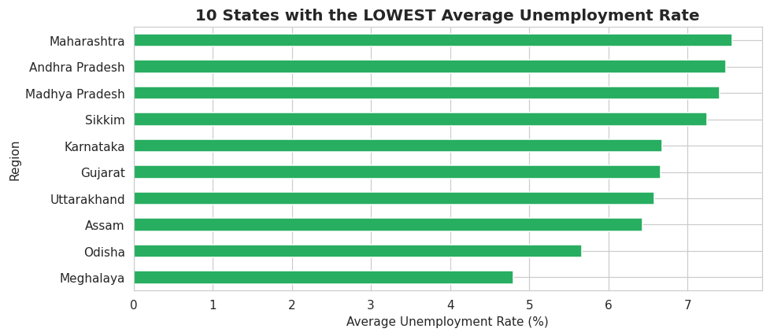
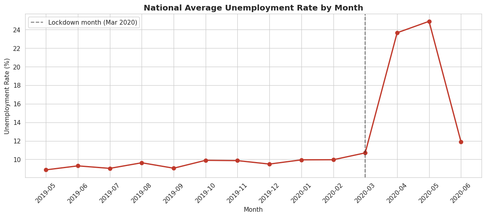
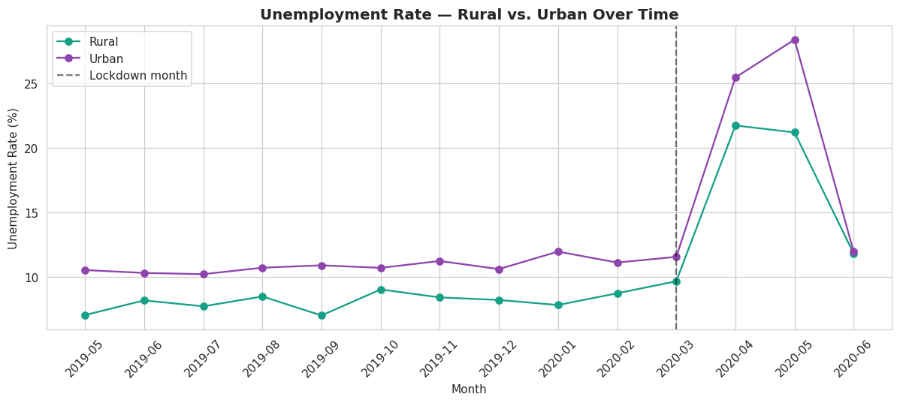
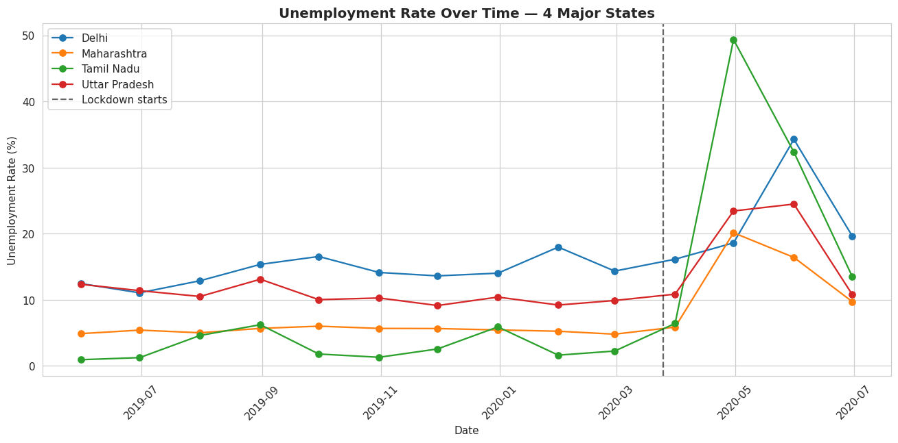
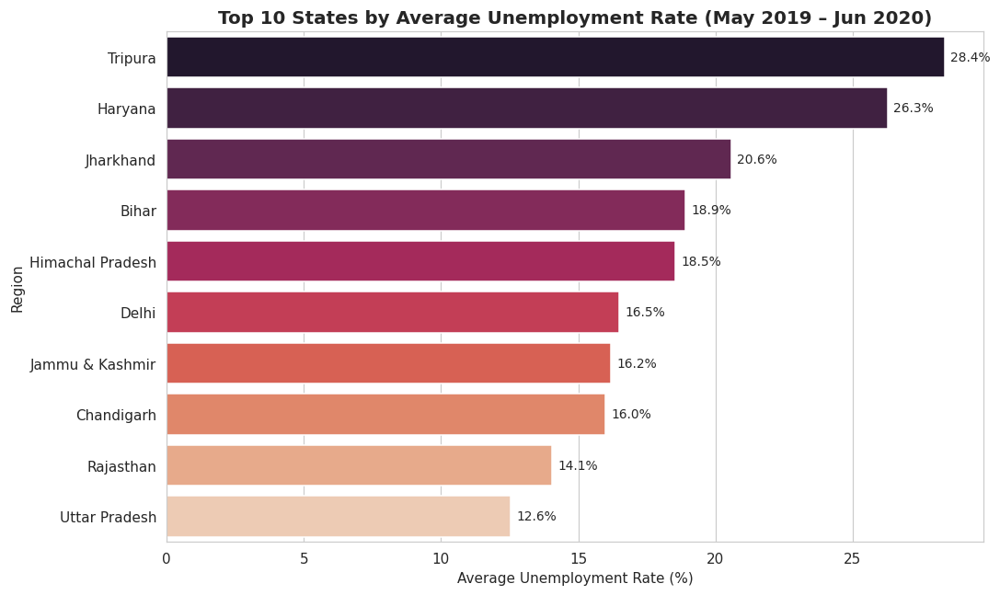

# Unemployment Analysis in India

<p align="center">
  <strong>Exploratory Data Analysis of Unemployment Trends & COVID-19 Impact</strong>
</p>

## About

This project explores unemployment data across Indian regions and over time.
The analysis focuses on regional variation, monthly trends, selected state-level
time series, labour-market correlations, and the change around the COVID-19 period.

## Objectives

- Understand regional differences in unemployment rates
- Identify monthly unemployment trends
- Compare unemployment patterns across major states
- Find the top 10 regions by average unemployment
- Examine correlations between unemployment, employment, and labour participation
- Compare pre-COVID and post-COVID averages

## Dataset

**Source:** [Unemployment in India — Kaggle](https://www.kaggle.com/datasets/gokulrajkmv/unemployment-in-india)

**File:** `Unemployment_Rate_upto_11_2020.csv`

The CSV is expected in the `data/` folder.

## Tools & Libraries

- Python
- pandas
- NumPy
- Matplotlib
- Seaborn
- Jupyter Notebook

## Project Structure

```text
Unemployment-Analysis-India/
│
├── Unemployment_Analysis_India.ipynb
├── data/
│   └── Unemployment_Rate_upto_11_2020.csv
│
├── visualizations/
│   ├── 01_region_average.png
│   ├── 02_monthly_trend.png
│   ├── 03_state_time_series.png
│   ├── 04_top_10_regions.png
│   ├── 05_correlation_heatmap.png
│   └── 06_pre_post_covid.png
│
├── README.md
├── requirements.txt
├── .gitignore
└── LICENSE
```

## Analysis Workflow

1. Load and inspect the dataset
2. Check missing values and duplicate rows
3. Clean text fields and convert data types
4. Calculate region-wise average unemployment
5. Analyze month-wise unemployment trends
6. Compare selected states over time
7. Identify the top 10 regions by average unemployment
8. Analyze correlations among labour-market indicators
9. Compare pre-COVID and post-COVID periods
10. Summarize the main observations

## Visualizations

### Region-wise Average Unemployment


### Monthly Unemployment Trend


### Selected States — Time Series


### Top 10 Regions by Average Unemployment


### Correlation Heatmap


### Pre-COVID vs Post-COVID


## Key Takeaways

The notebook documents the observations directly next to each analysis step.
In particular, it examines the pronounced change in unemployment around the
2020 COVID-19 lockdown period, regional differences, state-level variation,
and relationships among the main labour-market indicators.

> Correlation is used to describe association in the dataset; it does not by
> itself establish causation.

## How to Run

```bash
pip install -r requirements.txt
jupyter notebook Unemployment_Analysis_India.ipynb
```

## Author

**Salma Hossam**
